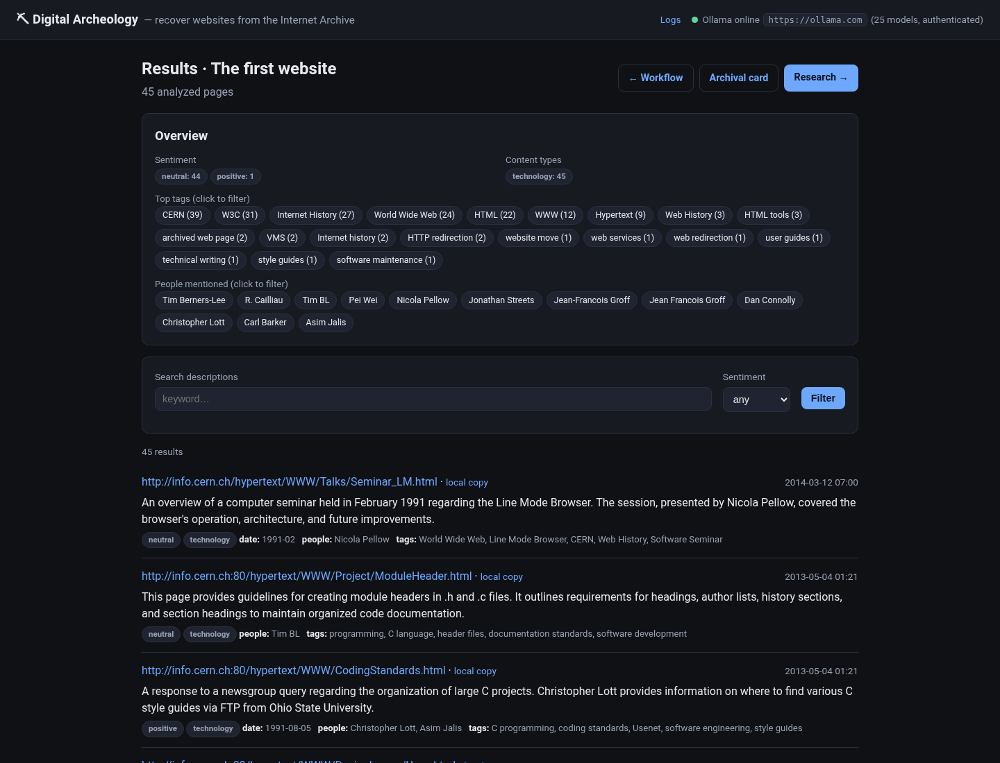
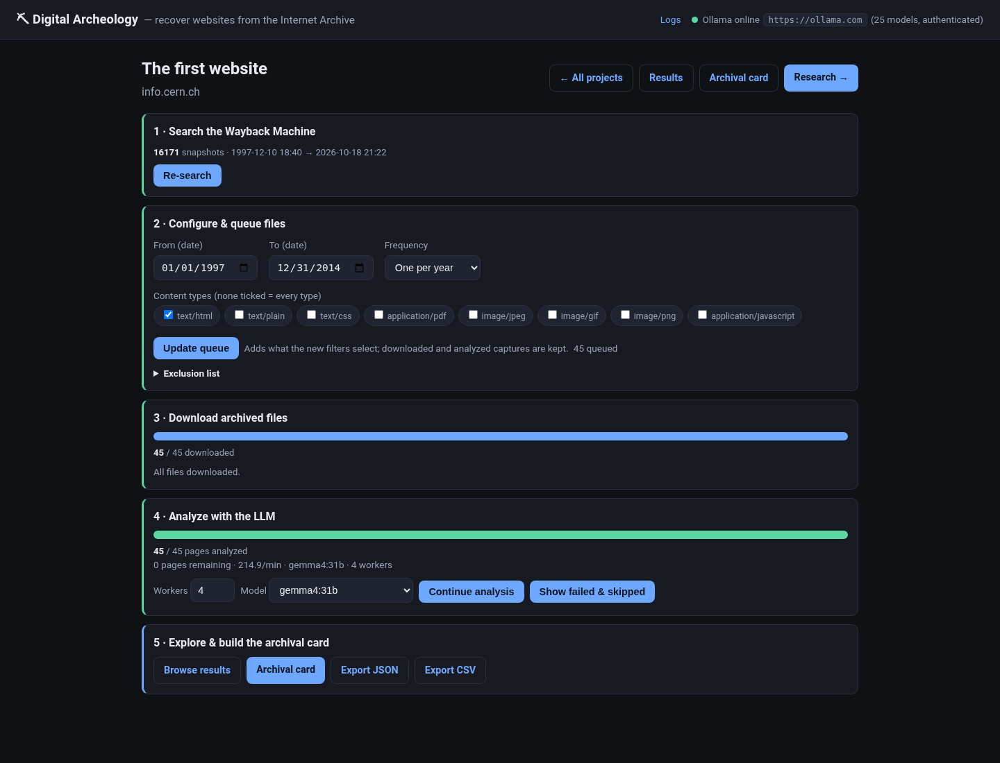
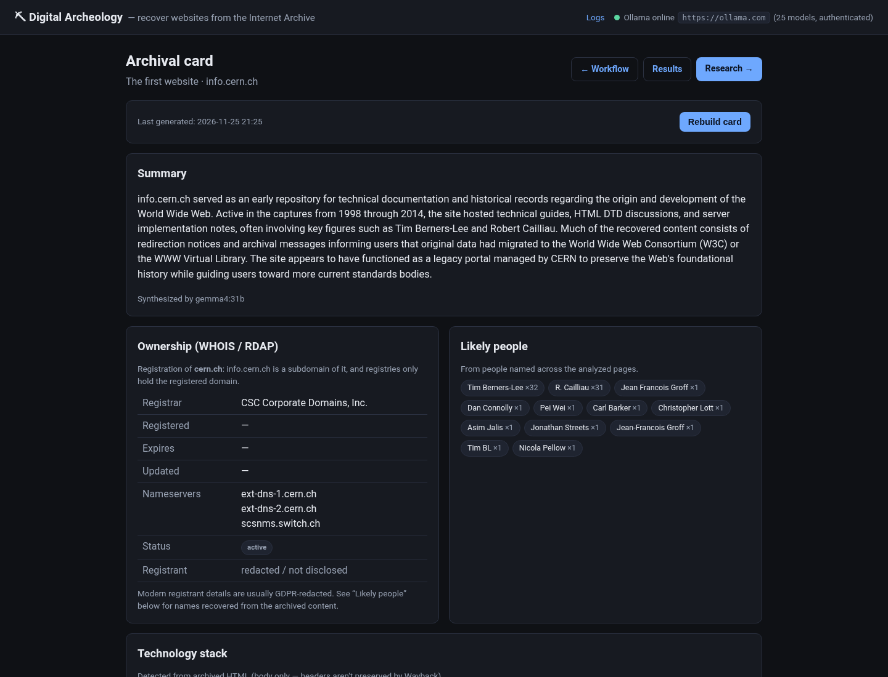

# Digital Archeology

Recover a website that no longer exists from the Internet Archive's Wayback
Machine, read it with a language model, and package what was found as an
archive a historian can cite.

You give it a domain. It lists every capture the Wayback Machine holds,
downloads the ones you choose, has an LLM describe each page (what it is, who it
names, when it was written, what it is about), and builds on that: the material
the site linked to, close readings of its articles, descriptions of image-only
pages, a profile of the domain, and a self-contained export that opens in any
browser with no server.



The app is a single FastAPI process with a server-rendered HTMX UI: no
JavaScript build, no Node, one SQLite database.

> **Run it on your own machine or LAN.** There is no login. Anyone who can
> reach the port can start jobs that spend your LLM credits, change or delete
> projects, and read the logs. Do not expose it to the internet as is.

## What it does

**Recovery**
- Searches the Wayback Machine (CDX API) for every capture of a domain, then
  queues a selection: date range, one capture per day, week, month or year,
  content types.
- Downloads the original bytes of each capture (`id_` replay, without the
  archive's toolbar) at a rate the Archive tolerates. Resuming retries failed
  downloads. Captures the Archive only holds as error pages or broken
  redirects are labeled as such instead of being counted as failures.
- **Exclusion list** per project: URL patterns (`/wp-admin/`, `*.css`, …) kept
  out of the corpus. A suggested list covers CMS plumbing.
- **Scope window**: when a domain expired and was taken over (spam farms are
  common), only the original era is analyzed. The later captures are kept as
  evidence.
- **Local viewer**: read any downloaded page in the browser, with its links and
  images pointing to the other local captures, without the Wayback Machine.
  Archived HTML is served sandboxed so its scripts never run.

**Analysis (LLM, through the Ollama API: local or hosted)**
- Per page: description, content type, estimated date, people, subjects,
  sentiment, tags. Duplicate captures are analyzed once and the result is
  copied to the others.
- **Linked material**: extracts every outbound link, recovers what it pointed
  to from the Archive, and classifies how the site related to it.
- **Close readings** of article-shaped pages: who acts, where, when the events
  happened (as distinct from publication), claims, quotes, intent.
- **Reader comments**, extracted without an LLM.
- **Image-only pages**: recovers their images and describes them with a vision
  model.
- **Archival card**: ownership (RDAP/WHOIS), technology stack detected offline
  from the HTML, capture timeline, people, and a written summary.

**Output**
- Search and browse results, research views (readings, chronology, links).
- **Export as a BagIt bag** (RFC 8493, every file with its SHA-256): HTML pages
  for findings, pages by year, links, people, readings, chronology and
  methodology, the same data as CSV and JSON, the exact prompts used, and the
  raw captures.
- JSON and CSV exports of the analysis.

**Operations**
- Progress, resume and stop for every job. A restart never loses work, and
  never resumes spending without a click.
- Spending guards: a cap on model calls per run, or a stop at a fraction of
  the quota a hosted endpoint reports.
- **Logs page** with everything the app did and every failure, filterable by
  project and level. The API key is redacted before anything is written.

## Quick start (Docker)

```bash
git clone https://github.com/vicosurge/digital-archeology.git
cd digital-archeology
cp .env.example .env        # then edit it: endpoint, key, model
docker compose up -d --build
```

Open http://localhost:8000. The database, downloads, logs and exports live in
`./data`.

### Choosing an LLM endpoint

Any server speaking the Ollama API works.

The app only speaks the Ollama API, and that is deliberate: with Ollama the
whole pipeline can run on your own machine, so the material you recover never
has to leave it when it should not, and there is no bill. The same API reaches
Ollama Cloud when you would rather not host the model yourself. For that reason
no other providers (OpenAI, Anthropic, Gemini, …) are built in. If you need one,
open an issue: it can be added on request.

- **Local Ollama**: `ollama serve`, `ollama pull <model>`, and leave
  `OLLAMA_HOST=http://host.docker.internal:11434`. Small models (3B) work for
  per-page analysis but write noticeably worse summaries.
- **Ollama Cloud**: `OLLAMA_HOST=https://ollama.com` plus `OLLAMA_API_KEY`.
  It is paid by usage. A site of a few hundred pages costs cents; one of ~10,000
  captures about a dollar for the per-page pass.

Model choice matters more than size:

- **`gemma4:31b`** is the recommended model. It returns clean structured output
  and has vision, which the image descriptions need.
- **Thinking models** (`gpt-oss`, `nemotron-3-*`, `minimax-m3`) spend their
  output budget on hidden reasoning, so at the default `LLM_NUM_PREDICT=500` the
  answer comes back cut off. The app reports this as "Cut off at the output
  limit" rather than a generic failure. Raise the limit or use another model.

Each project can switch models in step 4 of its page. Always use `https://`
for a remote endpoint: the key travels in a header.

### Settings

All settings are environment variables, listed with their defaults in
[`.env.example`](.env.example). The ones you are most likely to change:

| Variable | Default | |
|---|---|---|
| `OLLAMA_HOST` | `http://localhost:11434` | Endpoint URL |
| `OLLAMA_API_KEY` | empty | Bearer token; empty sends no auth header |
| `OLLAMA_MODEL` | `llama3.2:3b` | Default model for new projects |
| `LLM_CONCURRENCY` | 4 | Parallel model calls |
| `LLM_NUM_PREDICT` | 500 | Output token limit per call |
| `LLM_MAX_CALLS_PER_RUN` | 0 (off) | Hard ceiling on calls per run |
| `LLM_STOP_AT_SESSION_USAGE` | 0 (off) | Stop at this fraction of the endpoint's reported quota |
| `DA_DATA_DIR` | `./data` | Database, downloads, logs, exports |

On concurrency: a stock local `ollama serve` answers one request at a time, so
more workers only queue. Against ollama.com with `gemma4:31b`, 4 workers gave
38 calls/min, while 8 gave 23 calls/min with HTTP 429 errors.

## Using it

A project's page walks through five steps:



1. **Search the Wayback Machine** for the domain.
2. **Configure & queue**: dates, frequency, content types (none ticked means
   all), and the exclusion list. Updating the queue later adds to it and never
   removes what was already downloaded or analyzed.
3. **Download.** About one request per second, as the Archive expects.
4. **Analyze** with the chosen model. *Show failed & skipped* lists every page
   that did not make it and why. *Retry* requeues the failures.
5. **Explore**: results, the archival card, research views, export.



Long jobs can also run from the command line, which keeps going without a
browser tab:

```bash
docker exec -it digital-archeology python -m app.cli links-extract --project 1
#   links-extract | links-recover | links-analyze | links-requeue | links-stats
#   read-select | read-run | read-requeue | read-stats       (close readings)
#   comments                                                 (no LLM)
#   img-select | img-recover | img-describe | img-requeue | img-stats
```

Setting a scope window is deliberately a script rather than a button:

```bash
python3 scripts/set_scope.py --project 1                        # inspect
python3 scripts/set_scope.py --project 1 --end 20170101000000 \
    --reason "Domain expired after 2016 and was taken over."
python3 scripts/set_scope.py --project 1 --clear
```

## Running without Docker

```bash
cd backend
python3 -m venv .venv && . .venv/bin/activate
pip install -r requirements.txt
cd .. && ./run.sh            # reads .env, data in ./data
```

`RELOAD=1 ./run.sh` enables auto-reload while developing. Do not use it during a
long job, because every file change restarts the server and stops the job.

`backend/requirements.txt` pins every package to the versions the image is
tested with. To upgrade, install from `backend/requirements.in`, test, and
replace `requirements.txt` with the result of `pip freeze`.

## Project layout

```
backend/app/
  main.py, config.py, database.py, models.py, cli.py
  routers/     web.py (UI), research.py, projects.py + export.py (JSON API)
  services/    wayback, downloader, processing + llm + llm_client (analysis),
               links, reading, reception (comments), images, findings,
               archive_export (BagIt), local_view, exclusions, applog,
               enrichment (RDAP, timeline), techstack (fingerprints)
  templates/   Jinja2 pages and HTMX partials; export/ for the bag's pages
  static/      style.css, htmx.min.js
  data/fingerprints/   vendored technology fingerprints (GPL-3.0, see NOTICE)
scripts/       set_scope.py, crosscheck_archives.py, autoresume.sh, promote_dev_data.py
```

The JSON API is documented at http://localhost:8000/docs while the app runs.

## Being a good citizen of the Archive

The Internet Archive is a nonprofit. The downloader is deliberately slow (one
request per second, at most 40 per minute for linked material and images) and
backs off when throttled. Please keep it that way. Material you recover belongs
to its authors: cite the Wayback URL, which the export does for you.

## License

MIT, see [LICENSE](LICENSE). The technology fingerprints in
`backend/app/data/fingerprints/` come from the Wappalyzer project and are
GPL-3.0. htmx is 0BSD.
